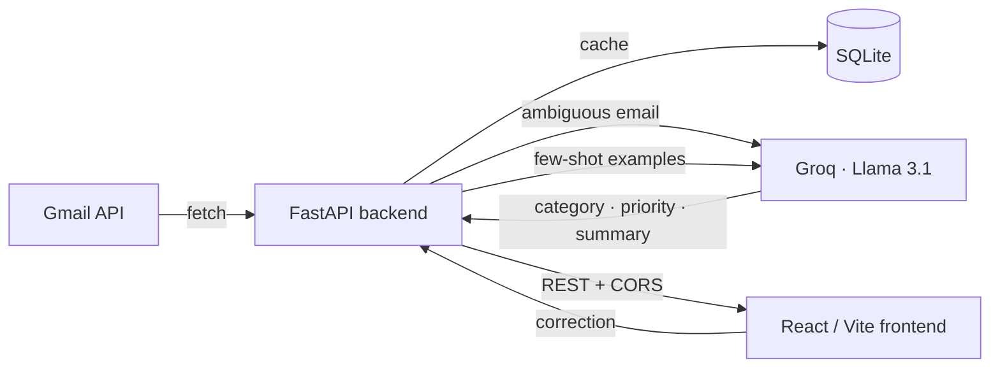

<div align="center">


<br/>

[](.)
[](.)
[](.)
[](.)
[](.)
[](.)

</div>

<br/>

## What is this

**Claro** connects to Gmail and uses an LLM to triage your inbox for you — every email gets classified into one of 18 intent-aware categories, tagged with a priority, summarized in a sentence, and (if it needs one) given a one-click AI-drafted reply. No emails leave your machine; the SQLite DB is local and read-only Gmail scopes are the default.

<div align="center">
<table>
<tr>
<td width="33%" align="center">🧠<br/><b>AI Classification</b><br/><sub>18 categories · priority · confidence</sub></td>
<td width="33%" align="center">⚡<br/><b>Smart Replies</b><br/><sub>one-click AI drafts, sent via Gmail</sub></td>
<td width="33%" align="center">🛡️<br/><b>Private by default</b><br/><sub>local SQLite · read-only scopes</sub></td>
</tr>
</table>
</div>

## How it decides

Claro doesn't send every email to the LLM. A regex pre-filter catches the obvious stuff (newsletters, promos, shipping notices) in ~5ms; everything ambiguous goes to Groq's `openai/gpt-oss-20b` with a structured JSON schema (category, priority, confidence, summary, suggestion, `requires_reply`, `follow_up_needed`). When you correct a bad label, that correction is stored and replayed to the model as a few-shot example on every future call — the classifier improves per-user with zero fine-tuning.



## Stack

<div align="center">

</div>

| Layer | Tech |
|---|---|
| Frontend | React 19, TypeScript, Vite, Tailwind CSS, Framer Motion, Recharts |
| Backend | FastAPI, SQLAlchemy, Pydantic |
| AI | Groq (`openai/gpt-oss-20b`), rule-based pre-filter |
| Data | Gmail API (OAuth2, PKCE), SQLite |

## Getting started

```bash
# backend
cd backend
python3 -m venv venv && source venv/bin/activate
pip install -r requirements.txt
cp .env.example app/.env        # add your GROQ_API_KEY
uvicorn app.main:app --reload --port 8001

# frontend
cd frontend
npm install
npm run dev -- --port 5174
```

Open `http://localhost:5174` and click **Connect Gmail to get started**. Without a `credentials.json`, the app falls back to a mock demo session automatically.

## API surface

```
GET   /health
GET   /auth/login   /auth/callback   /auth/status   POST /auth/logout
GET   /emails                     GET /emails/analytics
POST  /emails/classify            POST /emails/bulk-classify
POST  /emails/draft-reply         GET  /emails/drafts/{id}
POST  /emails/create-draft        POST /emails/send
POST  /emails/feedback            GET  /emails/feedback/stats
```

<div align="center">
<br/>


</div>
